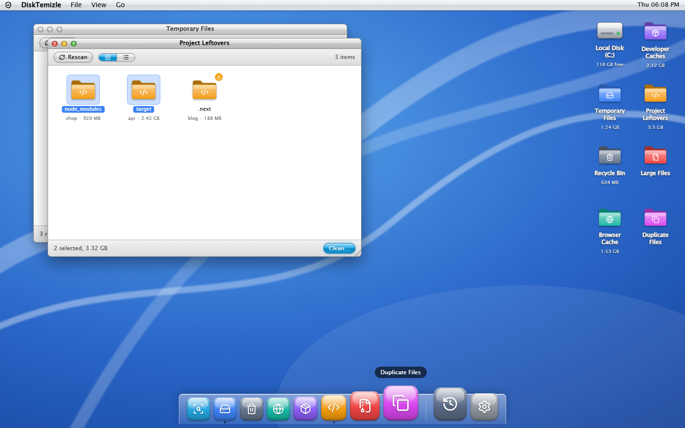
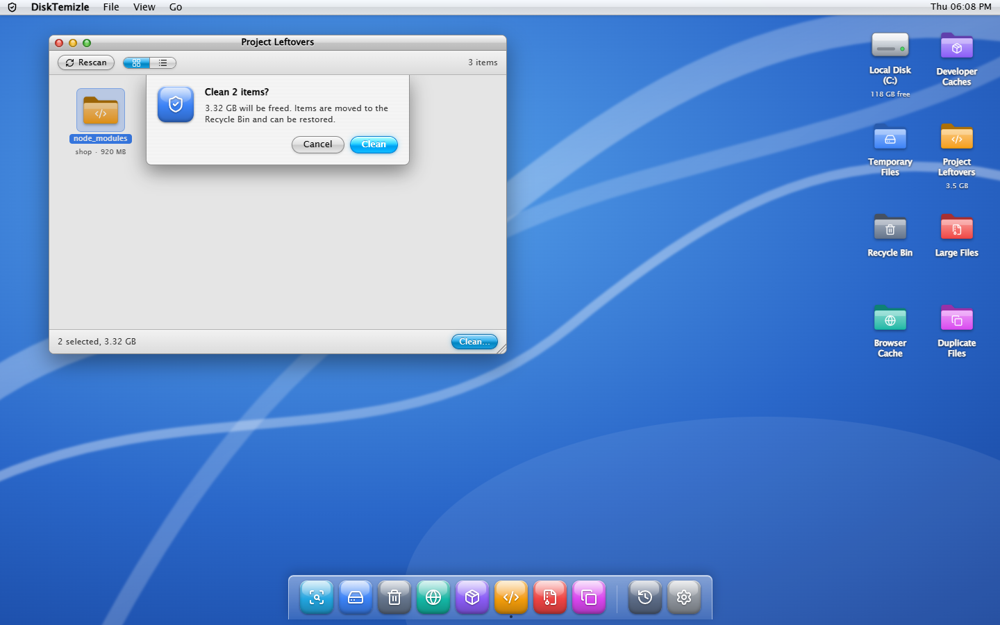
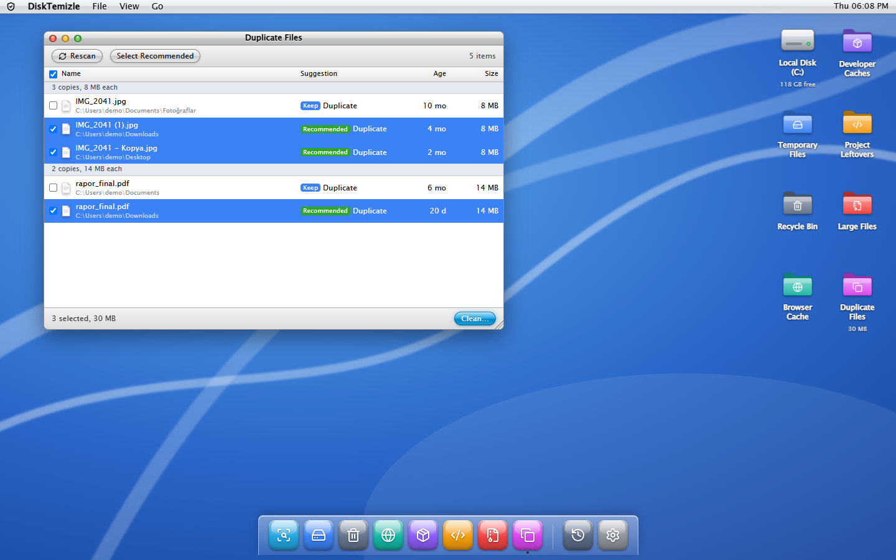
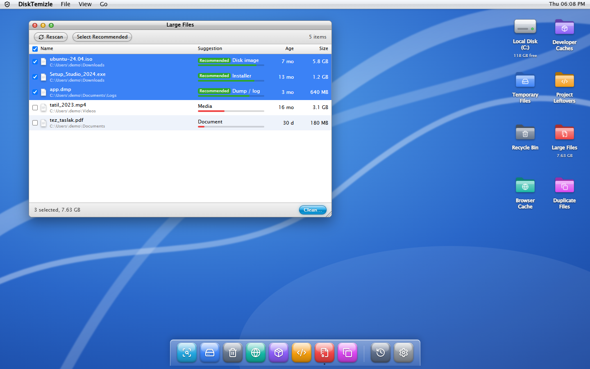
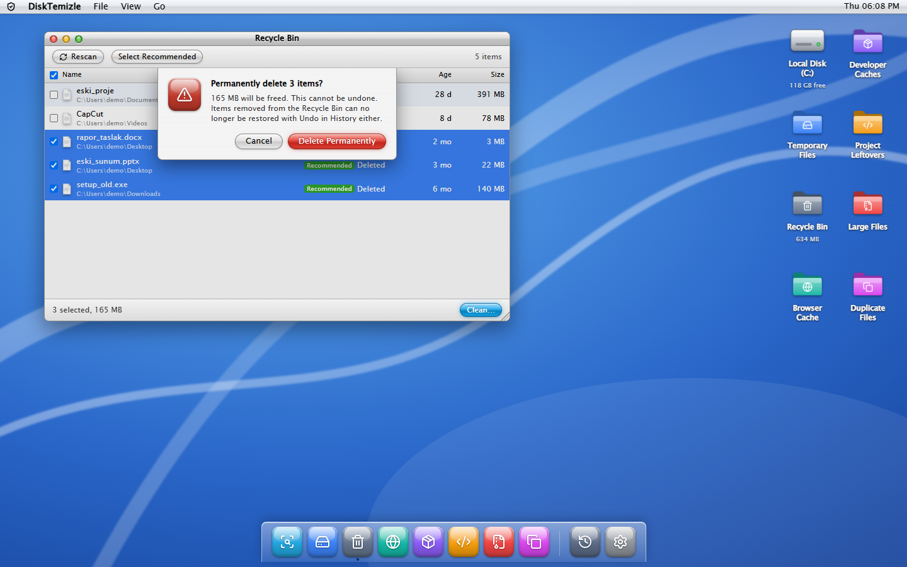
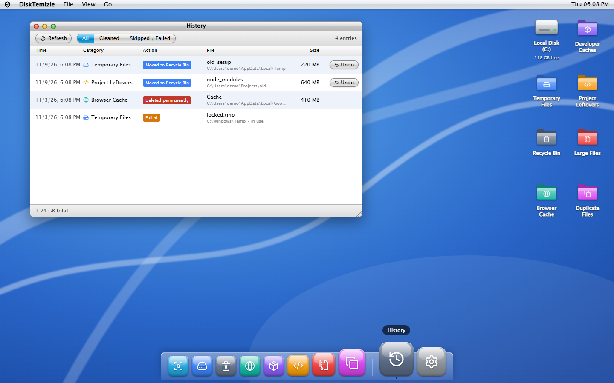
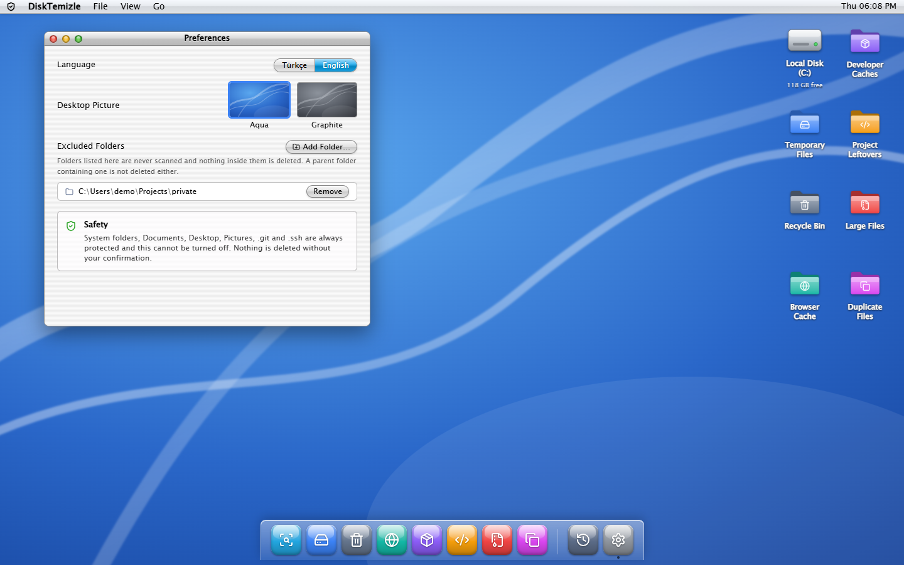
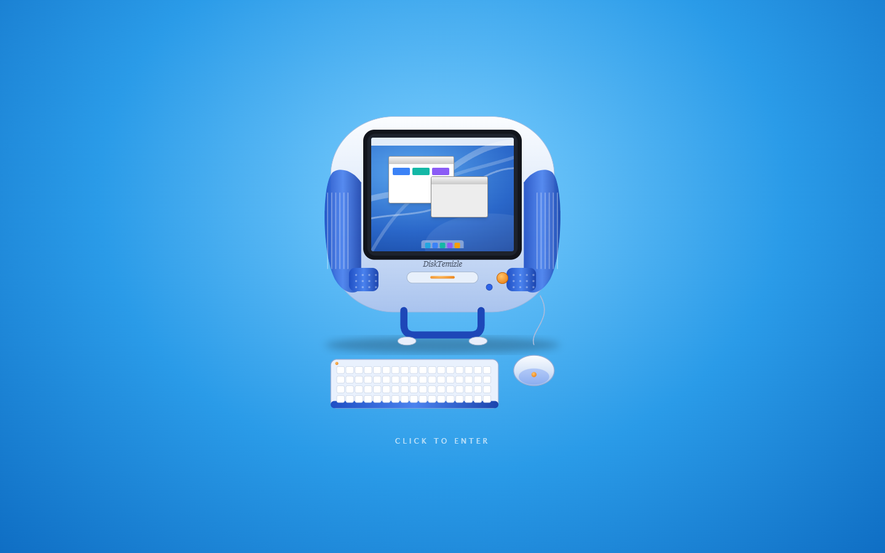

<div align="center">


# DiskTemizle

**A careful disk cleaner for Windows with a classic Mac OS X Aqua desktop.**
Finds temporary files, caches, project leftovers, large files and duplicates, and never touches what matters.

[](LICENSE)


**English** · [Türkçe](README.tr.md)



</div>

---

## Why DiskTemizle?

Most cleaners are either too timid to help or too aggressive to trust. DiskTemizle is built around one rule:
**nothing is deleted unless it passed a safety gate written in Rust, and anything that can be recovered goes to the Recycle Bin first.**

The interface is a love letter to Mac OS X Panther: a menu bar, desktop folders, a magnifying Dock, draggable Aqua windows and sheets, and an iMac intro. It is original vector artwork, and every window behaves like a small Finder.

## Features

| Category | What it finds | Default action |
| --- | --- | --- |
| **Temporary files** | `%TEMP%` and `Windows\Temp` entries. Items newer than 7 days are hidden, items touched in the last hour are flagged as *possibly in use*. | Recycle Bin |
| **Recycle Bin** | Everything already deleted, with sizes and age. Items older than 30 days are pre-selected. | Permanent (asks with a red warning) |
| **Browser cache** | Chrome, Edge and Firefox caches. Cookies, passwords and history are never touched. | Recycle Bin |
| **Developer caches** | npm and pip download caches. | Recycle Bin |
| **Project leftovers** | `node_modules`, `__pycache__`, `target`, `dist`, `build`, `.next`, `.gradle`. Folders such as `target` and `dist` count only when a sibling `Cargo.toml` or `package.json` proves they are build output. | Recycle Bin |
| **Large files** | Files over 100 MB with a 0-100 cleanup score and a reason (installer, archive, disk image, dump/log, ...). | Recycle Bin, **nothing pre-selected** |
| **Duplicate files** | Identical content found by size, then a partial hash, then a full BLAKE3 hash. One copy per group is always kept. | Recycle Bin, **nothing pre-selected** |

Also included: a **History** window that records every action and lets you **undo** anything still in the Recycle Bin, **excluded folders** that are never scanned or deleted, live scan progress with cancel, English and Turkish UI, and Aqua / Graphite wallpapers.

## Safety model

Safety is the product. Every deletion goes through several independent layers, and the UI is never trusted: **each path is re-validated in Rust right before it is touched.**

| Layer | What it does |
| --- | --- |
| **Protected paths** | System folders (`Windows`, `Program Files`, `ProgramData`), drive roots, and `.git`, `.ssh`, `.gnupg`, `.aws` anywhere in a path are never deletable. Personal folders (Documents, Desktop, Pictures, Videos, Music, Downloads, OneDrive, `AppData`) are only reachable by the categories that need them. |
| **Path hardening** | `..` is rejected, symlinks and junctions are resolved to their real target before checking, comparisons are case-insensitive, and every category has its own *allowed roots*. |
| **Running app guard** | A folder that contains the running executable can never be deleted (for example the `target` folder while you develop). |
| **Your exclusions** | An excluded folder blocks itself, everything inside it **and any parent that would delete it**. |
| **Recycle Bin first** | Permanent deletion exists only for regenerable caches and for emptying the Recycle Bin, both behind an explicit confirmation. |
| **Your files stay yours** | Large files and duplicates are never pre-selected. For duplicates, at least one copy always remains, and a file that changed after the scan is skipped. This is enforced in the UI and again in Rust. |
| **Journal and undo** | Every action is appended to a JSONL journal. Anything moved to the Recycle Bin can be restored from the History window. |
| **Cloud placeholders** | OneDrive "online-only" entries are skipped, so scanning never triggers a download. |

The safety gate, scanner and cleanup service have unit tests, including tests that try to escape with `..`, case tricks, parent folders of protected paths and the folder of the running executable.

## Screenshots

<table>
  <tr>
    <td width="50%"><br /><sub><b>Confirmation sheet.</b> Everything goes to the Recycle Bin and can be restored.</sub></td>
    <td width="50%"><br /><sub><b>Duplicates.</b> Grouped copies, a "Keep" badge and recommended copies you can select in one click.</sub></td>
  </tr>
  <tr>
    <td width="50%"><br /><sub><b>Large files.</b> A cleanup score and a reason for every file. Nothing is pre-selected.</sub></td>
    <td width="50%"><br /><sub><b>Recycle Bin.</b> Emptying is permanent, so the warning is red and focus starts on Cancel.</sub></td>
  </tr>
  <tr>
    <td width="50%"><br /><sub><b>History.</b> Every action with an Undo button while the item is still restorable.</sub></td>
    <td width="50%"><br /><sub><b>Preferences.</b> Language, wallpaper and excluded folders.</sub></td>
  </tr>
</table>

<details>
<summary>The intro</summary>
<br />

</details>

> The screenshots use the built-in demo data (`VITE_MOCK=1`), so no real files or paths of the author are shown.

## Getting started

### Requirements

- Windows 10 or 11 (WebView2 is preinstalled on Windows 11)
- [Node.js](https://nodejs.org) 22 or newer
- [Rust](https://rustup.rs) (stable) and the **MSVC Build Tools** (Visual Studio "Desktop development with C++")

### Run in development

```bash
npm install
npm run tauri dev
```

To work on the interface without touching your real disk, run it with demo data:

```powershell
$env:VITE_MOCK = "1"; npm run tauri dev
```

Running `npm run dev` and opening <http://localhost:1420> in a normal browser also uses demo data automatically.

### Build the installer

```bash
npm run tauri build -- --bundles nsis
```

The installer is written to `src-tauri/target/release/bundle/nsis/`. It installs per user and needs no administrator rights. The first build downloads the NSIS packaging tool.

> If you replace the icons, touch `src-tauri/build.rs` once so Cargo regenerates the Windows resource.

### Tests

```bash
cd src-tauri
cargo test --lib
```

Tests that look at your real disk or Recycle Bin are marked `#[ignore]` and run only on request, for example `cargo test --lib real_bin -- --ignored --nocapture`. They never delete anything except files they create themselves.

## Architecture

```
┌────────────────────────────┐        Tauri commands + events        ┌────────────────────────────┐
│ React + TypeScript (src/)  │ ────────────────────────────────────► │ Rust core (src-tauri/src/) │
│ Aqua desktop, Zustand store│ ◄──────────── scan-progress ───────── │ scan · finder · cleanup    │
└────────────────────────────┘                                       │ safety · recycle · settings│
                                                                     └────────────────────────────┘
```

| Module | Responsibility |
| --- | --- |
| `safety.rs` | The path gate: protected roots, hardening, exclusions, per-mode rules. |
| `scan.rs` | Parallel read-only scanner (rayon) with cancel and progress. |
| `finder.rs` | Large-file scoring, duplicate detection and the delete-time duplicate guard. |
| `recycle.rs` | Recycle Bin listing and purging. |
| `cleanup.rs` | Recycle Bin / permanent removal, JSONL journal, undo. |
| `settings.rs` | Persisted excluded folders. |
| `disk.rs` | Free and total space of the system drive. |

On the front end, `src/store.ts` holds the window manager and scan state, `src/components/` contains the menu bar, Dock, windows and sheets, and `src/lib/api.ts` is the only place that talks to Rust (with a demo-data fallback).

## Privacy

DiskTemizle makes **no network requests** and collects no telemetry. Its only files are the journal and settings in your app-data folder.

## Roadmap

- Scan drives other than the system drive
- Signed installers and a CSP hardening pass
- More cleanup categories (Windows Update leftovers, thumbnail caches)
- Right-click "Exclude this folder" from scan results

Ideas and bug reports are welcome in the issue tracker.

## Credits and disclaimer

The interface is inspired by the classic Mac OS X Aqua look. All icons, the wallpaper and the intro are original artwork drawn for this project. DiskTemizle is not affiliated with or endorsed by Apple Inc. Mac OS X and Aqua are trademarks of Apple Inc.

Built with [Tauri](https://tauri.app), [React](https://react.dev), [Tailwind CSS](https://tailwindcss.com), [Zustand](https://zustand-demo.pmnd.rs), [rayon](https://github.com/rayon-rs/rayon), [BLAKE3](https://github.com/BLAKE3-team/BLAKE3) and the [`trash`](https://crates.io/crates/trash) crate.

Always review what you are about to clean. The software is provided as is, see the license.

## License

[MIT](LICENSE) © 2026 Erdem
