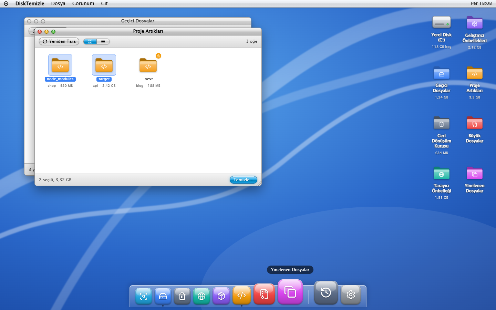
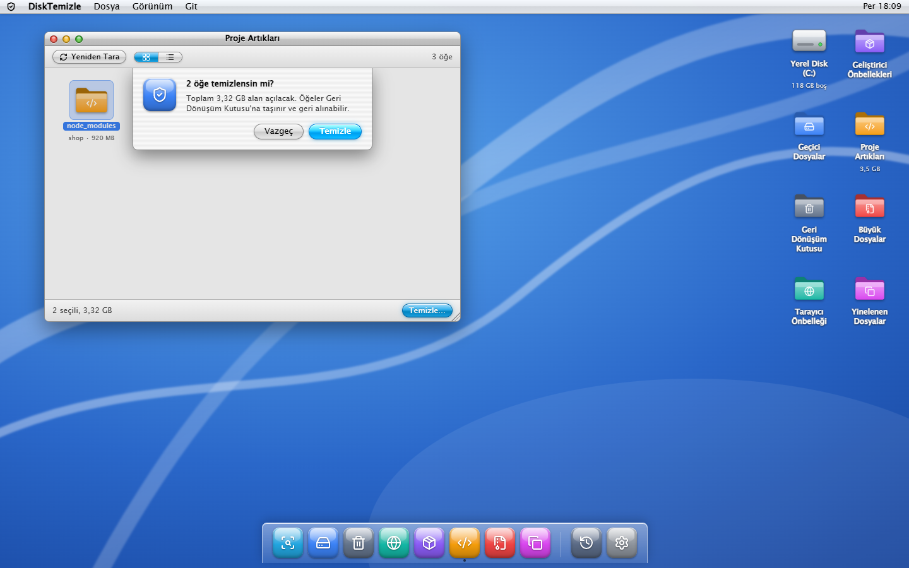
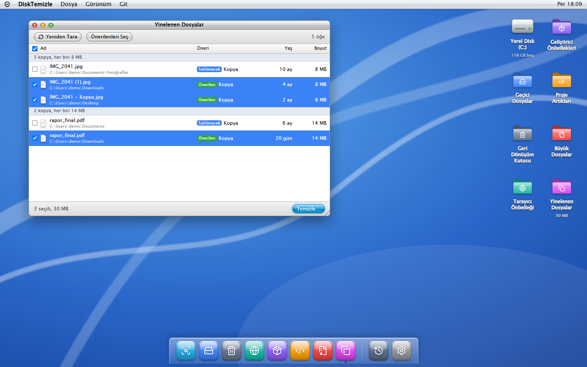
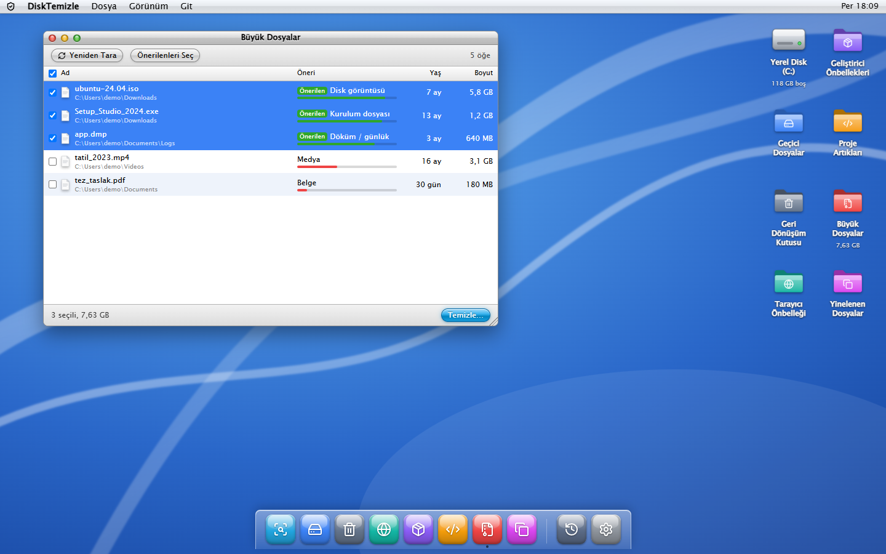
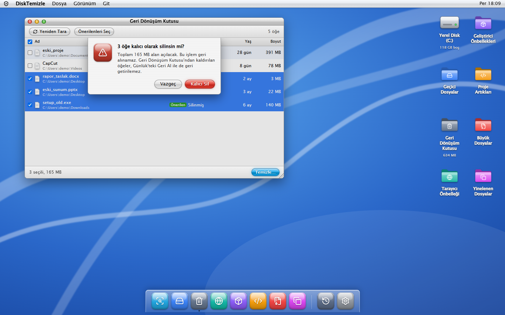
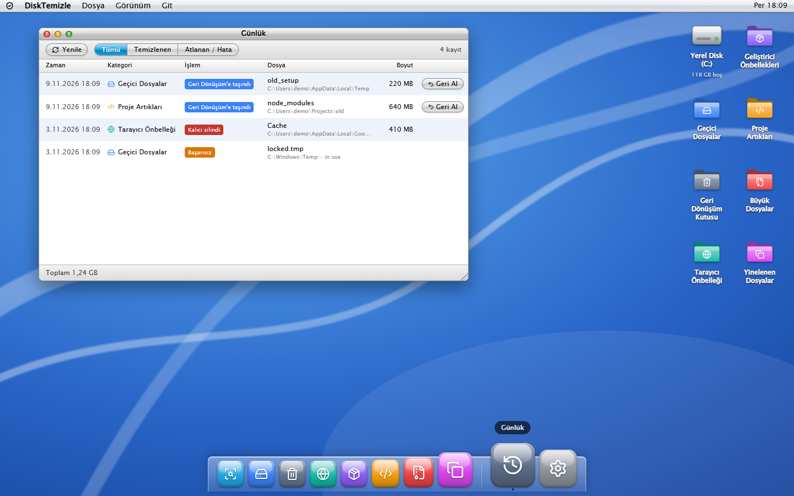
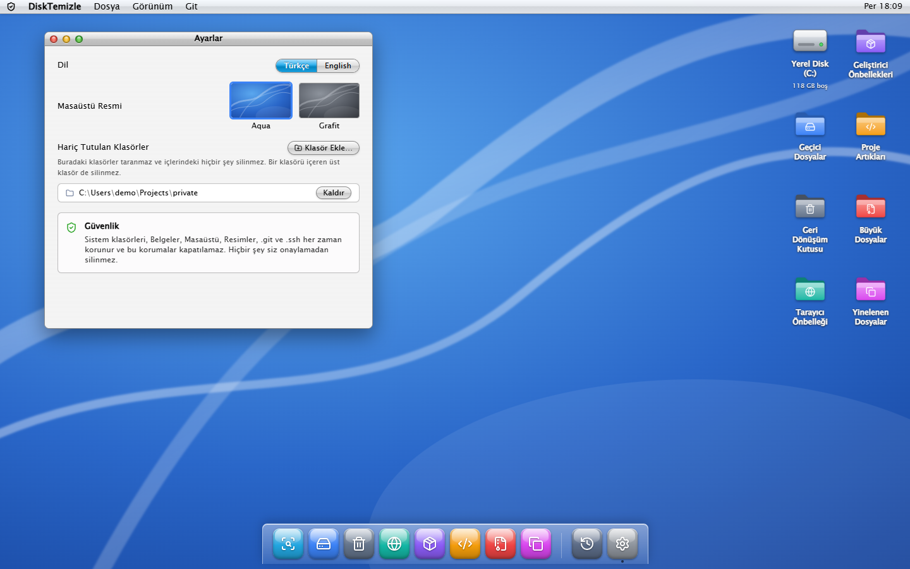
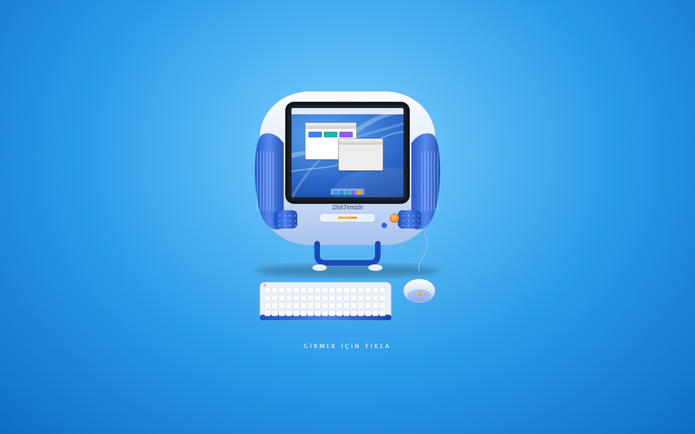

<div align="center">


# DiskTemizle

**Klasik Mac OS X Aqua masaüstüne sahip, dikkatli bir Windows disk temizleyici.**
Geçici dosyaları, önbellekleri, proje artıklarını, büyük ve yinelenen dosyaları bulur; önemli hiçbir şeye dokunmaz.

[](LICENSE)


[English](README.md) · **Türkçe**



</div>

---

## Neden DiskTemizle?

Çoğu temizleyici ya yardım edemeyecek kadar çekingen ya da güvenilemeyecek kadar saldırgandır. DiskTemizle tek bir kurala dayanır:
**Rust'ta yazılmış bir güvenlik kapısından geçmeyen hiçbir şey silinmez; geri alınabilecek her şey önce Geri Dönüşüm Kutusu'na gider.**

Arayüz, Mac OS X Panther'a bir saygı duruşudur: menü çubuğu, masaüstü klasörleri, büyüyen bir Dock, sürüklenebilir Aqua pencereler ve sayfalar, bir de iMac açılışı. Tamamı özgün vektör çizimdir ve her pencere küçük bir Finder gibi davranır.

## Özellikler

| Kategori | Ne bulur | Varsayılan eylem |
| --- | --- | --- |
| **Geçici dosyalar** | `%TEMP%` ve `Windows\Temp` öğeleri. 7 günden yeni öğeler gizlenir, son 1 saatte değişenler *kullanımda olabilir* diye işaretlenir. | Geri Dönüşüm Kutusu |
| **Geri Dönüşüm Kutusu** | Zaten silinmiş her şey, boyut ve yaşıyla. 30 günden eski öğeler önceden seçili gelir. | Kalıcı (kırmızı uyarıyla sorar) |
| **Tarayıcı önbelleği** | Chrome, Edge ve Firefox önbellekleri. Çerez, şifre ve geçmişe asla dokunulmaz. | Geri Dönüşüm Kutusu |
| **Geliştirici önbellekleri** | npm ve pip indirme önbellekleri. | Geri Dönüşüm Kutusu |
| **Proje artıkları** | `node_modules`, `__pycache__`, `target`, `dist`, `build`, `.next`, `.gradle`. `target` ve `dist` gibi klasörler yalnızca yanlarındaki `Cargo.toml` ya da `package.json` bunların derleme çıktısı olduğunu kanıtlarsa sayılır. | Geri Dönüşüm Kutusu |
| **Büyük dosyalar** | 100 MB üstü dosyalar; 0-100 arası temizleme puanı ve gerekçe (kurulum dosyası, arşiv, disk görüntüsü, döküm/günlük...). | Geri Dönüşüm Kutusu, **hiçbiri önceden seçilmez** |
| **Yinelenen dosyalar** | Aynı içerik; önce boyut, sonra kısmi hash, en son tam BLAKE3 hash'iyle bulunur. Her gruptan bir kopya her zaman kalır. | Geri Dönüşüm Kutusu, **hiçbiri önceden seçilmez** |

Ayrıca: her işlemi kaydeden ve Geri Dönüşüm'de duran her şeyi **geri almanızı** sağlayan **Günlük** penceresi, hiç taranmayan ve silinmeyen **hariç tutulan klasörler**, iptal edilebilir canlı tarama ilerlemesi, Türkçe ve İngilizce arayüz, Aqua / Grafit duvar kağıtları.

## Güvenlik modeli

Güvenlik bu ürünün kendisidir. Her silme birbirinden bağımsız birkaç katmandan geçer ve arayüze asla güvenilmez: **her yol, dokunulmadan hemen önce Rust'ta yeniden doğrulanır.**

| Katman | Ne yapar |
| --- | --- |
| **Korumalı yollar** | Sistem klasörleri (`Windows`, `Program Files`, `ProgramData`), sürücü kökleri ve yolun herhangi bir yerinde geçen `.git`, `.ssh`, `.gnupg`, `.aws` asla silinemez. Kişisel klasörlere (Belgeler, Masaüstü, Resimler, Videolar, Müzik, İndirilenler, OneDrive, `AppData`) yalnızca onlara ihtiyaç duyan kategoriler ulaşabilir. |
| **Yol sertleştirme** | `..` reddedilir, sembolik bağlantılar ve junction'lar denetlenmeden önce gerçek hedeflerine çözülür, karşılaştırmalar büyük/küçük harf duyarsızdır ve her kategorinin kendi *izinli kökleri* vardır. |
| **Çalışan uygulama koruması** | Çalışan yürütülebilir dosyayı içeren klasör asla silinemez (örneğin geliştirirken `target` klasörü). |
| **Sizin dışlamalarınız** | Hariç tutulan klasör kendini, içindeki her şeyi **ve onu silecek her üst klasörü** korur. |
| **Önce Geri Dönüşüm** | Kalıcı silme yalnızca yeniden üretilebilir önbellekler ve Geri Dönüşüm Kutusu'nu boşaltmak için vardır; ikisi de açık onay ister. |
| **Dosyalarınız sizindir** | Büyük ve yinelenen dosyalar hiçbir zaman önceden seçilmez. Yinelenenlerde her zaman en az bir kopya kalır, taramadan sonra değişen dosya atlanır. Bu hem arayüzde hem Rust'ta uygulanır. |
| **Günlük ve geri alma** | Her işlem bir JSONL günlüğüne eklenir. Geri Dönüşüm'e taşınan her şey Günlük penceresinden geri yüklenebilir. |
| **Bulut yer tutucuları** | OneDrive "yalnızca çevrimiçi" öğeler atlanır; tarama hiçbir zaman indirme tetiklemez. |

Güvenlik kapısı, tarayıcı ve silme servisi birim testlidir; `..`, büyük/küçük harf oyunları, korumalı yolların üst klasörleri ve çalışan yürütülebilir dosyanın klasörü ile kaçmaya çalışan testler dahildir.

## Ekran görüntüleri

<table>
  <tr>
    <td width="50%"><br /><sub><b>Onay sayfası.</b> Her şey Geri Dönüşüm Kutusu'na gider ve geri alınabilir.</sub></td>
    <td width="50%"><br /><sub><b>Yinelenenler.</b> Gruplanmış kopyalar, "Saklanacak" rozeti ve tek tıkla seçilen önerilen kopyalar.</sub></td>
  </tr>
  <tr>
    <td width="50%"><br /><sub><b>Büyük dosyalar.</b> Her dosya için temizleme puanı ve gerekçe. Hiçbiri önceden seçilmez.</sub></td>
    <td width="50%"><br /><sub><b>Geri Dönüşüm Kutusu.</b> Boşaltmak kalıcıdır; uyarı kırmızıdır ve odak "Vazgeç"te başlar.</sub></td>
  </tr>
  <tr>
    <td width="50%"><br /><sub><b>Günlük.</b> Her işlem; öğe hâlâ geri getirilebiliyorsa Geri Al düğmesiyle.</sub></td>
    <td width="50%"><br /><sub><b>Ayarlar.</b> Dil, duvar kağıdı ve hariç tutulan klasörler.</sub></td>
  </tr>
</table>

<details>
<summary>Açılış ekranı</summary>
<br />

</details>

> Ekran görüntüleri yerleşik demo verisiyle (`VITE_MOCK=1`) alındı; yazarın gerçek dosyaları ya da yolları görünmez.

## Başlarken

### Gereksinimler

- Windows 10 veya 11 (WebView2 Windows 11'de hazır gelir)
- [Node.js](https://nodejs.org) 22 veya üstü
- [Rust](https://rustup.rs) (stable) ve **MSVC Build Tools** (Visual Studio "C++ ile masaüstü geliştirme")

### Geliştirme modunda çalıştırma

```bash
npm install
npm run tauri dev
```

Gerçek diskinize dokunmadan arayüz üzerinde çalışmak için demo verisiyle başlatın:

```powershell
$env:VITE_MOCK = "1"; npm run tauri dev
```

`npm run dev` çalıştırıp sıradan bir tarayıcıda <http://localhost:1420> adresini açmak da demo verisini otomatik kullanır.

### Kurulum paketini üretme

```bash
npm run tauri build -- --bundles nsis
```

Kurulum dosyası `src-tauri/target/release/bundle/nsis/` altına yazılır. Kullanıcı bazlı kurulur, yönetici izni gerekmez. İlk derleme NSIS paketleme aracını indirir.

> İkonları değiştirirseniz, Cargo'nun Windows kaynağını yeniden üretmesi için `src-tauri/build.rs` dosyasına bir kez dokunun.

### Testler

```bash
cd src-tauri
cargo test --lib
```

Gerçek diskinize ya da Geri Dönüşüm Kutusu'na bakan testler `#[ignore]` işaretlidir ve yalnızca istenince çalışır, örneğin `cargo test --lib real_bin -- --ignored --nocapture`. Kendi oluşturdukları dosyalar dışında hiçbir şeyi silmezler.

## Mimari

```
┌────────────────────────────┐        Tauri komutları + olayları      ┌────────────────────────────┐
│ React + TypeScript (src/)  │ ────────────────────────────────────► │ Rust çekirdeği (src-tauri) │
│ Aqua masaüstü, Zustand     │ ◄──────────── scan-progress ───────── │ scan · finder · cleanup    │
└────────────────────────────┘                                       │ safety · recycle · settings│
                                                                     └────────────────────────────┘
```

| Modül | Sorumluluk |
| --- | --- |
| `safety.rs` | Yol kapısı: korumalı kökler, sertleştirme, dışlamalar, moda özel kurallar. |
| `scan.rs` | İptal ve ilerleme destekli, paralel (rayon) salt-okunur tarayıcı. |
| `finder.rs` | Büyük dosya puanlama, yinelenen tespiti ve silme anı yinelenen koruması. |
| `recycle.rs` | Geri Dönüşüm Kutusu listeleme ve boşaltma. |
| `cleanup.rs` | Geri Dönüşüm / kalıcı kaldırma, JSONL günlüğü, geri alma. |
| `settings.rs` | Kalıcı hariç tutulan klasörler. |
| `disk.rs` | Sistem sürücüsünün boş ve toplam alanı. |

Ön yüzde `src/store.ts` pencere yöneticisini ve tarama durumunu tutar, `src/components/` menü çubuğu, Dock, pencereler ve sayfaları içerir, `src/lib/api.ts` ise Rust ile konuşan tek yerdir (demo verisi yedeğiyle).

## Gizlilik

DiskTemizle **hiçbir ağ isteği yapmaz** ve telemetri toplamaz. Tek dosyaları, uygulama veri klasörünüzdeki günlük ve ayarlardır.

## Yol haritası

- Sistem sürücüsü dışındaki sürücüleri tarama
- İmzalı kurulum paketleri ve CSP sıkılaştırması
- Daha fazla temizlik kategorisi (Windows Update artıkları, küçük resim önbellekleri)
- Tarama sonuçlarında sağ tık "Bu klasörü hariç tut"

Fikirler ve hata bildirimleri için issue sayfasını kullanabilirsiniz.

## Katkılar ve uyarı

Arayüz klasik Mac OS X Aqua görünümünden esinlenmiştir. Tüm ikonlar, duvar kağıdı ve açılış ekranı bu proje için çizilmiş özgün çalışmalardır. DiskTemizle, Apple Inc. ile bağlantılı değildir ve onun tarafından onaylanmamıştır. Mac OS X ve Aqua, Apple Inc.'in ticari markalarıdır.

[Tauri](https://tauri.app), [React](https://react.dev), [Tailwind CSS](https://tailwindcss.com), [Zustand](https://zustand-demo.pmnd.rs), [rayon](https://github.com/rayon-rs/rayon), [BLAKE3](https://github.com/BLAKE3-team/BLAKE3) ve [`trash`](https://crates.io/crates/trash) kütüphanesiyle geliştirildi.

Temizlemeden önce neyi sildiğinizi her zaman gözden geçirin. Yazılım olduğu gibi sunulur, lisansa bakın.

## Lisans

[MIT](LICENSE) © 2026 Erdem
